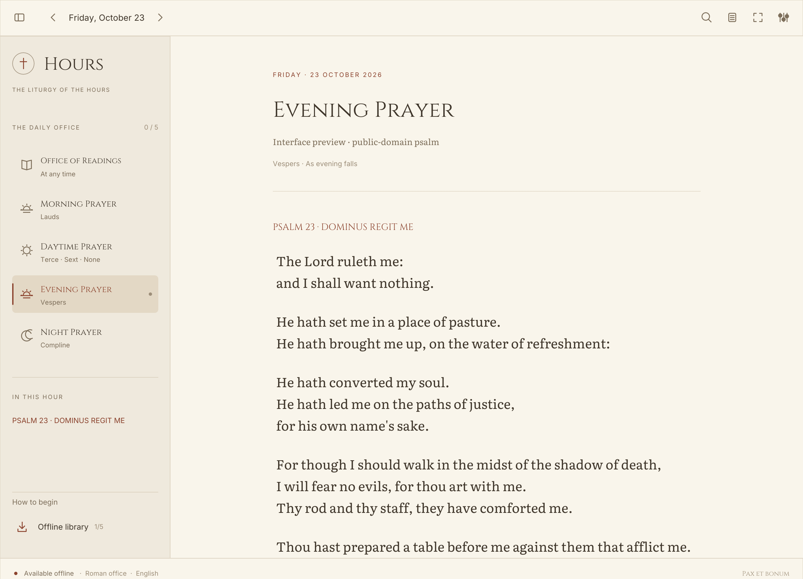

<p align="center">
  
</p>

<h1 align="center">Hours</h1>

<p align="center">The Liturgy of the Hours, on your desktop.</p>

<p align="center">
  <a href="https://github.com/chrisvo/hours-rs/actions/workflows/check.yml"></a>
  <a href="https://github.com/chrisvo/hours-rs/releases/latest"></a>
  <a href="LICENSE"></a>
  
</p>

<p align="center">
  <a href="https://github.com/chrisvo/hours-rs/releases/latest">Download for Mac</a> ·
  <a href="docs/getting-started.md">Getting started</a> ·
  <a href="CONTRIBUTING.md">Contribute</a> ·
  <a href="https://github.com/chrisvo/hours-rs/issues/new/choose">Report an issue</a>
</p>

<p align="center">
  <picture>
    <source media="(prefers-color-scheme: dark)" srcset="docs/images/reader-dark.png">
    
  </picture>
</p>

<p align="center"><sub>The actual native app with public-domain preview text. <a href="docs/preview/README.md">About these screenshots</a></sub></p>

Hours is a native Rust reader for the modern Roman Catholic Liturgy of the Hours in English. Download the dates you need, then pray, search, and keep notes without a connection. No account is required.

Inspired by [Rasmic's bible-rs](https://github.com/michaelshimeles/bible-rs). Built with [egui](https://github.com/emilk/egui), with bundled Cinzel headings and Literata prayer text.

## A place for daily prayer

- **The daily office.** Office of Readings, Morning Prayer, Daytime Prayer, Evening Prayer, and Night Prayer, with date navigation and a section list.
- **Your local library.** Explicit downloads, visible date coverage, and an offline mode. Reading and navigation never start network requests.
- **Your place and reflections.** Saved reading positions, notes, bookmarks, highlights, and prayer progress stay on your device.
- **A readable page.** Light, parchment, and dark themes, adjustable text size and spacing, focus mode, and keyboard controls.
- **A portable library.** Export a backup or import one on another device. Imports preserve existing texts and personal notes.

## Get Hours

Download **Hours for macOS on Apple Silicon** from the [latest release](https://github.com/chrisvo/hours-rs/releases/latest). Unzip it and move **Hours.app** to Applications.

This is an early release. The Mac app is ad-hoc signed and has not been notarized by Apple. See the [installation guide](docs/getting-started.md#install-on-macos) for details. Intel Macs, Windows, and Linux do not have verified release builds yet.

Prefer to build it yourself? Install [Rust](https://www.rust-lang.org/tools/install), then run:

```sh
git clone https://github.com/chrisvo/hours-rs.git
cd hours-rs
cargo run --release --locked
```

Rust 1.88 or later is required. [Contributor setup](CONTRIBUTING.md) includes checks and Mac packaging.

## Prepare for offline use

1. Choose a date and open **Offline library**.
2. Choose how many days to download and select **Download all hours**.
3. Wait for the dates you need to show **5/5 hours**.
4. Enable **Offline mode** and read from your local library.

**Offline coverage is limited to downloaded dates.** Hours does not contain a perpetual calendar or a bundled prayer corpus. A missing office stays visibly missing. iBreviary determines which dates and observances are available.

The Daytime Prayer document includes the midmorning, midday, and midafternoon options supplied by the source. Follow its rubrics to choose the appropriate text.

## Privacy and prayer texts

Hours has no accounts, analytics, or cloud sync. Downloads connect to iBreviary only when you request them. Fonts and app assets are bundled.

Prayer texts come from [iBreviary](https://www.ibreviary.org/en/) through personal downloads. They retain their publishers' copyrights and are **not covered by this project's MIT license**. Downloaded offices, personal notes, and backups are not included in the repository or release archive. Hours is an independent reader, not an official iBreviary app.

On macOS, your library is stored in `~/Library/Application Support/com.chrisvo.hours-rs/`. See [storage and backups](docs/getting-started.md#back-up-your-library).

## Documentation

- [Get started, pray offline, and back up your library](docs/getting-started.md)
- [Keyboard controls and command-line reference](docs/reference.md)
- [How the offline library works](docs/design/offline-library.md)
- [Contribute to Hours](CONTRIBUTING.md)
- [Release notes](CHANGELOG.md)
- [Report a security issue](SECURITY.md)

## Contribute

Bug reports, accessibility improvements, documentation, and platform testing are welcome. Start with [CONTRIBUTING.md](CONTRIBUTING.md), or open a [bug report or feature request](https://github.com/chrisvo/hours-rs/issues/new/choose). Use synthetic fixtures for tests and respect prayer-text licenses.

## License and credits

Application code is available under the [MIT license](LICENSE). Cinzel, Literata, and Inter use the [SIL Open Font License](assets/fonts). Release bundles include third-party notices.

Thanks to [bible-rs](https://github.com/michaelshimeles/bible-rs) for the reader inspiration, [iBreviary](https://www.ibreviary.org/en/) for its liturgical resources, and the maintainers of egui, SQLite, reqwest, and the other libraries that make Hours possible.
